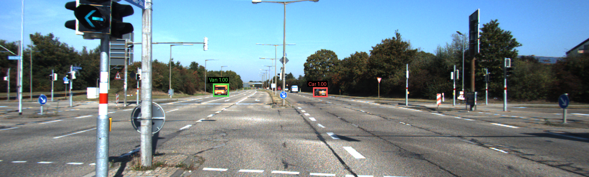

# YOLOv3 Object Detection on KITTI




A PyTorch pipeline for fine-tuning YOLOv3 on KITTI images: label conversion, reproducible splits, preprocessing, augmentation during training, pretrained weight loading, training, prediction, and evaluation.

This project uses a standalone YOLOv3 implementation initialized from the original Darknet COCO weights. Ultralytics `.pt` checkpoints are not interchangeable with this project's checkpoints.

## Classes

The class indices follow this order everywhere in the project:

```text
0 Car
1 Van
2 Truck
3 Pedestrian
4 Person_sitting
5 Cyclist
6 Tram
7 Misc
```

KITTI `DontCare` regions are stored separately and handled as ignore regions, rather than as a detection class.

## Project layout

| Path | Purpose |
| --- | --- |
| `configs/kitti.yaml` | Dataset path, classes, image size, seed, augmentation settings |
| `scripts/` | Dataset preparation, splitting, checks, pretrained weight loading |
| `models/` | YOLOv3 architecture and training loss |
| `utils/` | Dataset loader, transforms, postprocessing, metrics |
| `splits/kitti/` | Saved training, validation, and test image IDs |
| `train.py` | Fine-tuning and checkpoint saving |
| `evaluate.py` | Detection metrics and evaluation exports |
| `predict.py` | Annotated predictions and detection exports |
| `weights/` | Original pretrained weights and KITTI initialization checkpoint |
| `outputs/finetune/` | Fine-tuned checkpoints and training history |
| `outputs/metrics_val_tuned/` | Validation metrics at the selected reporting threshold |
| `outputs/metrics_test_tuned/` | Test metrics using the same threshold |
| `outputs/predictions_tuned/` | Annotated prediction examples |

Run the following commands from the project root.

## Installation

Use Python 3.10 or newer. To create an environment:

```bash
conda create -n yolov3-kitti python=3.11 pip
conda activate yolov3-kitti
```

If you already use the project's `cv` environment, use `conda activate cv` instead.

Install the appropriate PyTorch build using the [official installation selector](https://pytorch.org/get-started/locally/), then install the remaining dependencies:

```bash
python -m pip install -r requirements.txt
```

The dependency file specifies compatible version ranges; it is not a record of the exact environment used for the reported training run. Record the installed versions when reproducing an experiment:

```bash
python -m pip show torch numpy Pillow PyYAML opencv-python
```

Device selection defaults to NVIDIA CUDA when available, then Apple MPS, then CPU. Use `--device cuda`, `--device mps`, or `--device cpu` to select a device explicitly. An NVIDIA GPU requires a compatible driver and CUDA-enabled PyTorch installation. The same model can run on an Apple Silicon Mac through MPS.

## 1. Prepare the dataset

Download the KITTI object detection images and labels from the [KITTI website](https://www.cvlibs.net/datasets/kitti/eval_object.php?obj_benchmark=2d). Keep the original files here:

```text
data/kitti/training/image_2/<image_id>.png
data/kitti/training/label_2/<image_id>.txt
```

Set `dataset_root: data/kitti`, `image_size: 416`, and the eight class names in `configs/kitti.yaml`. Convert the original labels:

```bash
python scripts/prepare_kitti.py --config configs/kitti.yaml
```

Conversion creates YOLO labels under `data/kitti/prepared/labels/` and separate ignore-region annotations under `data/kitti/prepared/ignore/`. YOLO boxes use normalized center coordinates, width, and height. Retain the original KITTI labels.

## 2. Create splits and inspect boxes

For a new dataset setup:

```bash
python scripts/split_and_inspect_kitti.py --config configs/kitti.yaml --samples 10
```

The default split is 70% training, 15% validation, and 15% test. `--samples 10` draws ten annotation previews per split; it does not limit training to ten images. Inspect the previews in `outputs/dataset_checks/`.

The project's existing split contains 5,236 training images, 1,122 validation images, and 1,123 test images. Reuse the committed `splits/kitti/` files to reproduce results. Do not overwrite them after training.

These are local splits of KITTI's labeled training set. KITTI's official unlabeled testing images are not the local test set used by `evaluate.py`. Random image splits can contain similar scenes across partitions; use sequence groups through `--groups` when reliable sequence metadata is available.

## 3. Preprocess and augment

The dataset loader converts images to RGB, letterboxes them to the configured square size, converts them to channel-first tensors, and scales pixel values to `[0, 1]`. Box coordinates follow the same geometric transformations.

Training augmentation runs on the fly and includes horizontal flips, color changes, scaling, and translation. Configure it in `configs/kitti.yaml`. Validation and test loading use deterministic preprocessing without augmentation.

## 4. Load pretrained weights

```bash
python scripts/load_pretrained.py --config configs/kitti.yaml --download
```

This downloads the original COCO-trained `yolov3.weights` and saves `weights/yolov3_kitti_init.pt`. Compatible pretrained layers are transferred; the three detection output layers are initialized for KITTI's eight classes.

If the Darknet weights already exist, omit `--download`. This initialization checkpoint is separate from the fine-tuned model.

## 5. Fine-tune

Run a short training check first:

```bash
python train.py --epochs 1 --max-batches 2 --run-dir outputs/smoke
```

Train on an NVIDIA GPU:

```bash
python train.py --epochs 50 --device cuda --run-dir outputs/finetune
```

Omit `--device cuda` for automatic device selection. Defaults include batch size 4, learning rate `0.0001`, three initial epochs with the backbone frozen, and early stopping after ten epochs without validation-loss improvement. Reduce `--batch-size` if GPU memory is insufficient.

Validation loss is computed after every epoch. Training uses AdamW and a learning-rate schedule. The loss is this project's YOLOv3-style implementation, so training is not an exact reproduction of the original Darknet training recipe.

Saved files:

- `best.pt`: checkpoint with the lowest validation loss; used by prediction and evaluation by default.
- `last.pt`: latest training checkpoint, including state needed to resume training.
- `history.csv`: training and validation loss by epoch.

The best checkpoint is selected by validation loss, not mAP. The trainer does not compute mAP after each epoch. Smoke-run checkpoints are only for checking the pipeline.

Use a new run directory for a new experiment. Existing output directories are protected against accidental overwrite. To resume an interrupted run, use `--resume outputs/finetune/last.pt` with the original run configuration and run directory.

## 6. Postprocess and visualize predictions

```bash
python predict.py --weights outputs/finetune/best.pt --split val --limit 20 \
  --conf 0.996568 --iou 0.45 --output outputs/predictions_tuned
```

Postprocessing decodes the model outputs, filters detections by confidence, applies class-aware non-maximum suppression, and maps boxes back to the original image coordinates.

Confidence is objectness probability multiplied by class probability. `--conf 0.996568` keeps detections scoring at least that value. It is a threshold, not measured accuracy. Annotated images show class names and confidence scores. Different classes can retain overlapping boxes because suppression is class-aware.

To predict a separate image or directory, replace the example path:

```bash
python predict.py --source path/to/image.png --conf 0.996568 \
  --output outputs/predictions_external
```

Prediction exports include annotated images and JSON detections. Use a fresh output directory when rerunning. Annotation previews and prediction images are implemented; automated loss plots, precision-recall plots, and per-class AP charts remain future visualization work. `history.csv` contains loss values, not per-epoch accuracy or mAP.

## 7. Evaluate validation and test performance

Select a confidence threshold using validation results, then keep it fixed for the test evaluation:

```bash
python evaluate.py --weights outputs/finetune/best.pt --split val \
  --report-conf 0.996568 --output outputs/metrics_val_tuned

python evaluate.py --weights outputs/finetune/best.pt --split test \
  --report-conf 0.996568 --output outputs/metrics_test_tuned
```

The evaluator keeps a low prediction floor (`--conf 0.001` by default) to compute AP across confidence thresholds. `--report-conf` sets the operating threshold for precision, recall, and F1. Do not raise the AP prediction floor to `0.996568` when you want the full precision-recall curve. Changing only the reporting threshold does not change AP.

The evaluation protocol is:

- Precision, recall, and F1: micro-averaged over classes, at matching IoU 0.50 and the reporting confidence threshold.
- AP: class-aware, one-to-one matching and 101-point interpolated precision.
- mAP50 and mAP75: mean AP at IoU 0.50 and 0.75 respectively.
- mAP50_95: mean AP over IoU 0.50 through 0.95 in steps of 0.05.
- Unmatched predictions overlapping `DontCare` regions are ignored according to the configured intersection-over-prediction-area threshold; valid-object matches take precedence.
- Classes without ground-truth objects are excluded from the AP average.

The NMS setting `--iou 0.45` is separate from evaluation matching IoUs. This evaluates all eight classes without KITTI difficulty filtering. It is a custom evaluation protocol, not the official KITTI R40 benchmark or a complete reproduction of the COCO evaluator.

Each evaluation exports `metrics.json`, `per_class.csv`, `pr_curves.csv`, and `predictions.json`. Use the full split for final reports; results from `--limit` are only subset checks.

## 8. Prediction examples


## 9. Publish code, weights, and results

Keep raw KITTI data and local environments out of Git. A suitable `.gitignore` for publishing the selected weights and results is:

```gitignore
.venv/
venv/
__pycache__/
*.py[cod]
data/
.idea/
.DS_Store
outputs/finetune/last.pt
```

Remove blanket `weights/`, `outputs/`, `*.pt`, or `*.weights` rules if they are present and you intend to publish those files. Ignoring `last.pt` leaves the file on your computer. If it is already tracked, stop tracking it with:

```bash
git rm --cached outputs/finetune/last.pt
```

Install [Git LFS](https://git-lfs.com/) and configure it before adding model files:

```bash
git lfs install
git lfs track "*.pt" "*.weights"
git add .gitattributes
```

Commit the source files, configuration, requirements, README, saved split IDs, `outputs/finetune/best.pt`, `outputs/finetune/history.csv`, tuned metric folders, and selected prediction examples. Include initialization weights if you want them available directly; the download command also lets users recreate them. If large weights are already in Git history, LFS tracking alone does not convert the earlier commits.

After cloning a repository containing LFS weights, run:

```bash
git lfs install
git lfs pull
```

Check the applicable KITTI dataset terms and pretrained model licenses before redistributing third-party assets. Choose a license for your own project code before describing it as open source.

## References

- [YOLOv3 paper](https://arxiv.org/abs/1804.02767)
- [Original YOLO project and pretrained weights](https://pjreddie.com/darknet/yolo/)
- [KITTI object detection benchmark](https://www.cvlibs.net/datasets/kitti/eval_object.php?obj_benchmark=2d)
- [PyTorch installation](https://pytorch.org/get-started/locally/)
- [Git LFS configuration](https://docs.github.com/en/repositories/working-with-files/managing-large-files/configuring-git-large-file-storage)
